**[Portfolio](https://manmad-web.github.io/portfolio-console/)** &nbsp;·&nbsp; **[LinkedIn](https://www.linkedin.com/in/manishmadishetty)** &nbsp;·&nbsp; **[Email](mailto:mma310@sfu.ca)**

---

Hi, I'm Manish. I'm a Computer Science major (Statistics minor) at **Simon Fraser University**, graduating December 2027. I build AI systems that are grounded, tested and accountable: agents that cite their sources, evaluations that catch harm before users do, and products people want to use.

## Right now

| | |
| --- | --- |
| **AI Analyst Co-op**, BC Government (Connected Services BC) | Building a [PyRIT](https://github.com/Azure/PyRIT)-based red-teaming and evaluation service for a multi-agent RAG system, with Crescendo and TAP attacks and LLM-as-judge scoring. |
| **Undergraduate Researcher**, SFU | Researching how LLMs can detect accounting and audit fraud: an agent that reviews financial statements and cites the exact accounting rule broken. |
| **ZENJI** | Building a zero-sugar fermented gut-health drink that upcycles imperfect produce. |

## Projects

Everything I've built, each listed once. The [portfolio](https://manmad-web.github.io/portfolio-console/) has the full write-ups.

**AI safety & research**

| Project | What it is |
| --- | --- |
| [**IntelliAudit**](https://github.com/manmad-web/IntelliAudit) | A standards-citation benchmark for LLM financial auditing. It scores whether a system can name the governing ASC reference for a violation on real 10-K data, with deterministic ground truth. |
| [**SignShield**](https://github.com/manavjuthani/signshield) | A temporal defense against adversarial traffic-sign attacks (CMPT 310, with Adam Silver and Manav Juthani). A ResNet-18 CNN-LSTM with temporal attention held 98.4% accuracy when 6 of 8 frames were attacked, against 67.1% for a majority-vote baseline. |
| **Audit agent** | Research at SFU: an agent that reviews financial statements and cites the exact accounting rule broken, grounded in 17,800+ standards. |
| **Red-teaming service** | PyRIT-based adversarial testing of a multi-agent RAG system for the BC Government, with Crescendo and TAP attacks and LLM-as-judge scoring. |
| **GovernAI** | A multi-agent AI output evaluation platform built at TechVest Global. It scores 44 behavioral metrics and maps outputs to the EU AI Act, NIST AI RMF and ISO 42001. |

**Products & competitions**

| Project | What it is |
| --- | --- |
| [**AskSFU**](https://github.com/manmad-web/AskSFU-Chatbot) | SFU's first AI-powered student support chatbot (LangChain, GPT-4, RAG vs GraphRAG). It answers questions on courses, professors, clubs and maps and reads uploaded schedules and transcripts. UI/UX People's Choice Award. |
| **Moment Intelligence** | An AI supplier discovery dashboard for Moment Energy, with FEOC-compliant supplier discovery and a multi-agent RAG pipeline. 1st place at the Chang Institute Catalyst Challenge. |
| [**SFSS Nexus**](https://github.com/AnasHassar/276-Project) | A group-of-five Spring Boot web app (CMPT 276) that puts transit, weather, campus events and clubs on one dashboard for SFU students. |
| **ZENJI** | A zero-sugar synbiotic gut-health drink that upcycles imperfect produce. Second runner-up, Chang Institute Top Idea Prize. |

**Coursework & tools**

| Project | What it is |
| --- | --- |
| [**Rate CS Staff**](https://github.com/manmad-web/rate-cs-staff) | A full CRUD Spring Boot app with Thymeleaf and PostgreSQL for rating CS teaching staff, with validation and a full test suite (CMPT 276). |
| [**Portfolio Console**](https://github.com/manmad-web/portfolio-console) | My portfolio as an interactive 3D mechanical keyboard in plain HTML, CSS and SVG. [Live site](https://manmad-web.github.io/portfolio-console/). |

## Recognition

- 🥇 **1st Place**, Chang Institute Catalyst Challenge (SFU)
- 🏅 **UI/UX People's Choice Award**, AskSFU (SFU Faculty of Applied Sciences)
- 🥉 **Second Runner-up**, Chang Institute Top Idea Prize, for ZENJI
- 📜 Canadian Securities Course · Bloomberg Market Concepts · Certified ScrumMaster

## Tools I use

**Languages:** `Python` `Java` `JavaScript` `SQL` `C++` `HTML/CSS` `Shell`  
**AI / ML:** `PyTorch` `torchvision` `ResNet-18` `CNN + LSTM` `scikit-learn` `NumPy` `OpenCV` `LangChain` `LangGraph` `AutoGen` `CrewAI` `PyRIT` `RAG` `GraphRAG` `GPT-4 / GPT-4o`  
**Web & backend:** `React` `Node.js` `Spring Boot` `Thymeleaf` `FastAPI` `REST` `Tailwind CSS`  
**Data & infra:** `PostgreSQL` `pgvector` `SEC EDGAR / XBRL` `Docker` `OpenShift` `Azure` `AWS` `Git / CI/CD`  
**AI-assisted dev:** `Claude Code` `Cursor` `Windsurf` `Mem0` `n8n` `Base44` `Emergent` `Google Stitch`  
**Product & design:** `UI/UX` `Cognitive walkthroughs` `Product requirements` `Market sizing` `Unit economics`

## Beyond the code

Associate VP at the Simon Fraser Student Society, Faculty of Applied Sciences ambassador, and calculus and financial-literacy mentor. Outside of work I swim, dance, trade and read up on startup culture.

---

Always happy to talk AI safety, evaluation, audit tech and startups.
**[Say hello →](mailto:mma310@sfu.ca)**

